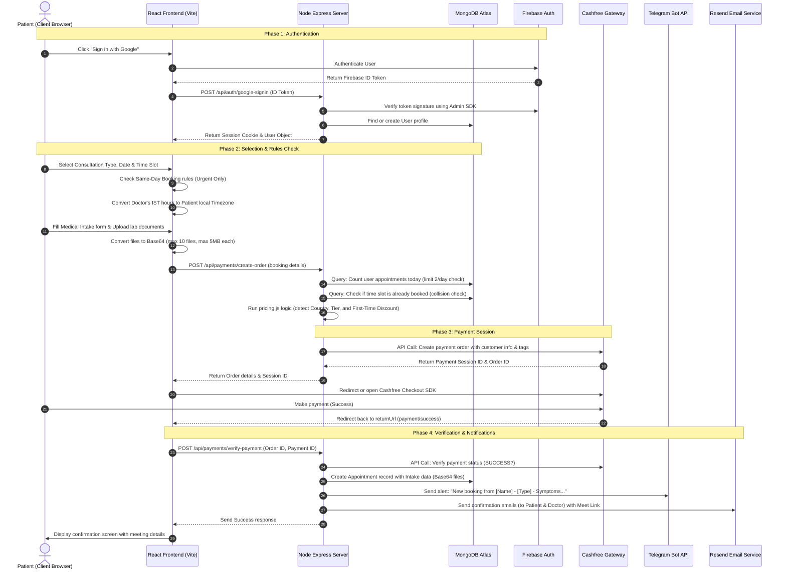

# NephroConsult - Complete Developer & System Architecture Learning Guide

Welcome to the comprehensive learning guide for **NephroConsult** (nephroconsultation.com), an international telemedicine platform designed for expert kidney care and consultations with **Dr. Ilango S. Prakasam** (Senior Nephrologist).

This guide explains the entire architecture, step-by-step user flows, dynamic pricing conditions, and integrations from scratch. It is designed to help developers, students, and stakeholders understand how the platform is built and how its internal logic works.

---

## 1. System Architecture & Tech Stack

NephroConsult is designed as a modern, decoupled client-server web application using a monorepo structure.

### 🌐 Frontend (Client-Side)
*   **Framework:** React 18.3 (TypeScript) for robust, type-safe components.
*   **Build Tool:** Vite 6.3 (fast compilation, hot reloading, and optimized build assets).
*   **Styling:** Tailwind CSS for a modern, responsive user interface.
*   **UI Components:** Radix UI primitives (accessible dropdowns, dialogs, progress bars, etc.).
*   **Routing:** React Router (client-side routing).
*   **Authentication:** Firebase Authentication (for Google Sign-In) + custom backend fallback.

### ⚙️ Backend (Server-Side)
*   **Runtime & Framework:** Node.js + Express.js.
*   **Database:** MongoDB Atlas (Cloud Database) with Mongoose ODM (Object Document Mapper).
*   **Session Management:** Express-Session with a MongoDB-backed store (`connect-mongo`) to persist user sessions securely.
*   **Scheduled Jobs:** Agenda library (backed by MongoDB) to run background workers and task scheduling.

### 🔌 Third-Party Integrations
*   **Firebase SDK:** Token verification on the backend for secure Google logins.
*   **Cashfree Payment Gateway:** SDK integration for processing regional card payments, UPI, and net banking.
*   **Resend Email API:** Outbound transactional emails (booking confirmations, prescriptions, invoices).
*   **Telegram Bot API:** Instant notifications sent directly to the doctor's Telegram chat.

---

## 2. Interactive System Flow Diagram

The following diagram illustrates how the client, backend, database, and external services interact during a typical booking and payment flow:



---

## 3. End-to-End User Journey

### Step 1: Browse & Register
Patients land on the website where they can view doctor credentials, patient testimonials, and services. They sign in using Google Login (using Firebase Auth under the hood) or via Email/Password.

### Step 2: Book Consultation
Patients navigate to `/book` to schedule their consultation. The website guides them through a step-by-step wizard:
1.  **Consultation Type Selection:** Choose Initial, Follow-up, or Urgent.
2.  **Date & Time Selection:** Interactive calendar indicating available times.
3.  **Patient Information:** Input contact information and basic profile.
4.  **Medical Document Upload:** Provide medical history and upload kidney lab reports.
5.  **Payment & Confirm:** Checkout securely.

### Step 3: Telehealth Video Call
Once booking is confirmed, an automated **Google Meet** link is generated and sent to both the patient and doctor. At the scheduled time, both parties log in for the consultation.

### Step 4: Prescription & Treatment Plan
After the call, Dr. Ilango uploads a digital prescription. The patient receives an email alert and can view their prescription instantly in their secure dashboard under `/profile`.

---

## 4. Key Business Rules & Code Logic ("The Conditions")

The NephroConsult platform relies on strict validation rules in both the Frontend (Vite/React) and Backend (Express) to prevent booking errors, abuse, or scheduling conflicts.

### Condition A: Same-Day Booking Rule
To ensure Dr. Ilango can manage his schedule, patients cannot book regular appointments for the current day.
*   **Rule:** Today's date is **disabled** on the booking calendar unless the user selects an **Urgent Consultation**.
*   **Frontend Logic (`BookingPage.tsx`):**
    ```typescript
    const isDateDisabled = (day: number) => {
      const date = new Date(year, month, day);
      const todayStart = new Date(today.getFullYear(), today.getMonth(), today.getDate());

      // Disable past dates
      if (date < todayStart) return true;

      // Same-day booking restriction: only urgent consultations can book for today
      const isToday = day === today.getDate() && month === today.getMonth() && year === today.getFullYear();
      if (isToday && consultationType !== 'urgent') {
        return true;
      }
      return false;
    };
    ```

### Condition B: Doctor Availability Hours
Dr. Ilango's consulting hours vary by appointment urgency:
*   **Regular Consultations (Initial & Follow-up):** Available in the evening only: **6:00 PM to 10:00 PM IST** (India Standard Time).
*   **Urgent Consultations:** Available all day: **10:00 AM to 10:00 PM IST**.
*   **Timezone Conversion:** The frontend automatically detects the visitor's local timezone (e.g., Eastern Time, Greenwich Mean Time) and shifts the displayed hours to match their local clock, preventing errors.

### Condition C: Same-Day Future Lead Time
For same-day bookings, patients cannot book slots in the past or slots starting in the immediate future.
*   **Rule:** Time slots must be at least **1 hour in the future** from the current moment.
*   **Backend & Utility Logic:** Filter out slots that are less than 60 minutes away.

### Condition D: Daily Appointment Limit
To prevent spam bookings and system abuse:
*   **Rule:** A single user is limited to a maximum of **2 active appointments per calendar day**.
*   **Backend Enforced Logic (`bookings.js`):**
    ```javascript
    const userTodayAppointments = await Appointment.countDocuments({
      date,
      'patient.id': req.session.user.id,
      status: { $ne: 'cancelled' }
    });
    if (userTodayAppointments >= 2) {
      return res.status(409).json({ 
        error: 'Maximum 2 appointments allowed per day per user. Please choose a different date.' 
      });
    }
    ```

### Condition E: Booking Collisions (Double-Booking Prevention)
No two patients should be scheduled for the same slot at the same time.
*   **Rule:** A time slot is locked once paid.
*   **Database Check:**
    ```javascript
    const existing = await Appointment.findOne({ date, timeSlot, status: { $ne: 'cancelled' } });
    if (existing) return res.status(409).json({ error: 'Time slot already booked' });
    ```

### Condition F: Medical Document Upload Guidelines
Patients can upload medical records and previous prescriptions.
*   **Format:** Files are read using the HTML FileReader API and converted to **Base64 strings** to allow simple transmission over API payloads.
*   **Rules:** Maximum of **10 files** per consultation intake. Maximum size is **5MB** per file.

---

## 5. Dynamic Pricing System (`pricing.js`)

Pricing is structured into **Three Regional Tiers** to accommodate patients from different socioeconomic regions while maintaining international standards.

### The Regional Tiers
1.  **Tier A (South Asia - India, Pakistan, Bangladesh, Nepal, Sri Lanka):**
    *   **Currency:** INR (₹)
    *   **Base Prices:**
        *   Initial Consultation: **₹499**
        *   Follow-up: **₹399**
        *   Urgent: **₹999**
2.  **Tier B (Middle-Income Countries - Brazil, Indonesia, South Africa, Turkey, Mexico, etc.):**
    *   **Currency:** USD ($)
    *   **Price Calculation:** `Tier A Base Price × 1.8 (Multiplier)` converted to USD.
3.  **Tier C (High-Income Countries - USA, Canada, UK, Australia, EU, Japan, Singapore, UAE, etc.):**
    *   **Currency:** USD ($)
    *   **Flat Target Pricing:**
        *   Initial Consultation: **$29**
        *   Follow-up: **$19**
        *   Urgent: **$49**

### First-Time User Discount
*   **Discount:** **20% off** the consultation price.
*   **Condition:** Applied only to **Tier A** and **Tier B** countries. Stored dynamically on first-time checkups (`isFirstTime === true`).

### Pricing Calculation Flow Chart
```
                      [Detect User Country / Timezone]
                                     │
                 ┌───────────────────┼───────────────────┐
                 ▼                   ▼                   ▼
            [Tier A: IN/PK/BD]    [Tier B: BR/MX/ZA]   [Tier C: US/UK/EU]
                 │                   │                   │
            Base INR Pricing     1.8x Multiplier      Flat Target USD
                 │                   │               ($29 / $19 / $49)
                 └─────────┬─────────┘                   │
                           ▼                             │
                 [First-Time User?]                      │
                 ┌─────────┴─────────┐                   │
                 ▼ (Yes)             ▼ (No)              │
              20% Off             Full Price             │
                 └─────────┬─────────┘                   │
                           ▼                             ▼
                 [Convert to Display Currency & Charge final Amount]
```

---

## 6. Payment Processing Flow (Cashfree Integration)

Cashfree is integrated to process global payments securely without holding sensitive card information on NephroConsult servers.

```
┌───────────┐         Order Data          ┌────────────┐        Session ID        ┌───────────┐
│  Patient  ├────────────────────────────>│  Backend   ├─────────────────────────>│ Cashfree  │
│  Browser  │                             │  Service   │                          │ Gateway   │
│           │<────────────────────────────┤            │<─────────────────────────┤           │
│           │     Payment Session ID      └────────────┘      Order Creation      └───────────┘
│           │
│           │       Redirect & Pay        ┌────────────┐
│           ├────────────────────────────>│ Cashfree   │
│           │                             │ Secure UI  │
│           │<────────────────────────────┤            │
│           │        Successful Pay       └────────────┘
│           │
│           │     Verify Order & ID       ┌────────────┐
│           ├────────────────────────────>│  Backend   │
│           │                             │ Verification
│           │<────────────────────────────┤  Endpoint  │
│           │      Confirm & Save Appt    └────────────┘
└───────────┘
```

### The Detailed Step-by-Step Payment Process:

1.  **Initiating an Order:**
    *   The frontend sends user details and appointment scheduling requests to `/api/payments/create-order`.
    *   The backend validates inputs using Zod, maps a unique ID (e.g. `order_T_1720958432_a3b2cf`), snapshots booking data temporarily into the user session, and calls Cashfree's `createOrder` API.
    *   Cashfree replies with a `paymentSessionId`.

2.  **Checkout Interaction:**
    *   The backend passes the `paymentSessionId` to the frontend.
    *   The frontend initializes the Cashfree JS SDK and redirects the user or loads the secure Cashfree Checkout component.
    *   The user completes payment via card, UPI, net banking, or wallet.

3.  **Redirection and Verification:**
    *   Upon successful payment, Cashfree redirects the client's browser back to:
        `https://nephroconsultation.com/payment/success?order_id={order_id}`.
    *   The React frontend immediately invokes the verification endpoint `/api/payments/verify-payment`.

4.  **Backend Robust Recovery:**
    *   Because mobile browsers sometimes drop cookies or session states during redirect, the verification endpoint does **not** strictly require cookie authentication.
    *   Instead, the server queries the Cashfree API using the `order_id` to verify if it is indeed `PAID`.
    *   It extracts booking tags from the Cashfree order meta metadata (which acts as a backup payload storage) to retrieve the original appointment details (e.g., patient name, timezone, intake symptoms).
    *   Once validated, the backend permanently saves the `Appointment` to the MongoDB database and flags it as `status: 'confirmed'`.

---

## 7. Integrated Alerts & Notifications

Once an appointment transitions to `confirmed`, the server triggers two automatic notifications:

### 1. Telegram Notification Bot (For Dr. Ilango)
A message is immediately dispatched to the doctor's Telegram chat so he can prepare:
> **🚨 New Consultation Booked!**
> *   **Patient:** John Doe (johndoe@email.com)
> *   **Type:** Initial Consultation
> *   **Date:** 2026-07-20
> *   **Time Slot:** 07:00 PM - 07:45 PM IST
> *   **Medical History:** High Blood Pressure since 2020.
> *   **Symptoms:** Swollen ankles, fatigue.
> *   **Meet Link:** [Join Call](https://meet.google.com/...)

### 2. Email Confirmation (For Patient & Doctor)
Sent via the Resend API using branded HTML templates containing the scheduling details, receipt confirmation, and Google Meet link.

---

## 8. Summary of Mongoose Database Schemas

### A. User Schema
Represents patients and doctors in the system.
*   `name`: Patient's name.
*   `email`: Unique email address.
*   `phone`: Validated contact number.
*   `country`: Country detected from locale.
*   `firebaseUid`: Google identifier token (optional fallback).

### B. Appointment Schema
Records all history, intake forms, and scheduling details.
*   `patient`: Nested patient profile snapshot (id, name, email, phone, country).
*   `doctor`: Snapshot of the consulting doctor.
*   `date`: Date string formatted as `YYYY-MM-DD`.
*   `timeSlot`: Scheduled hour (e.g., `06:30 PM`).
*   `type`: Mapped name (e.g., "Initial Consultation").
*   `status`: State of appointment (`confirmed`, `completed`, `cancelled`).
*   `price`: Pricing metadata (amount, currency, symbol, multiplier applied).
*   `meetLink`: Google Meet URL.
*   `intake`: Medical description and array of Base64 document attachments.
*   `prescription`: Digital prescription file uploaded by doctor (after appointment).

### C. ChatTicket Schema
Used for internal support ticketing and customer queries.
*   `ticketId`: Unique string formatted as `CT-YYYYMMDD-###`.
*   `category` / `priority` / `status`: Standard ticket states.
*   `messages`: Thread array of messages with sender, text, and timestamp.
*   `userEmail`: Patient's email who opened the ticket.

---

This educational guide details the entire flow. Feel free to use this document to understand the underlying code and structure of the NephroConsult Telemedicine application!
